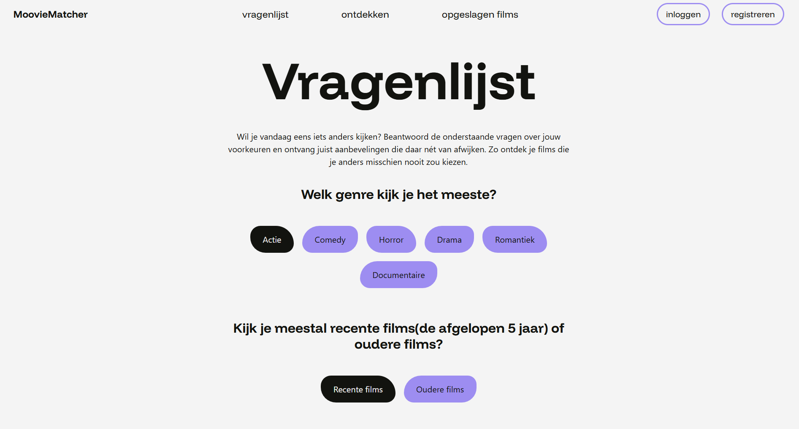
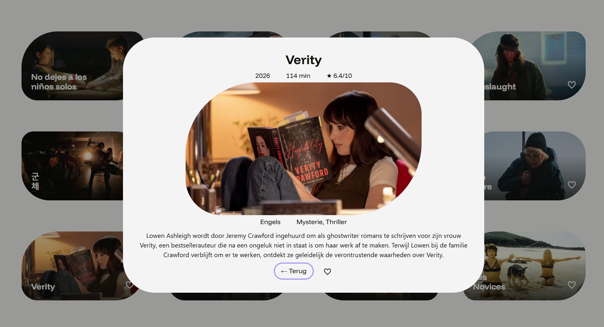

# MoovieMatcher

MoovieMatcher is een full-stack webapplicatie waarmee gebruikers nieuwe films kunnen ontdekken. Via een korte vragenlijst ontvangen gebruikers filmaanbevelingen die juist net anders zijn dan wat ze normaal kijken. Daarnaast kunnen ze films zoeken, filteren op genre en hun favoriete films opslaan in een persoonlijk account.

De applicatie bestaat uit een React-frontend en een eigen backend gebouwd met Java en Spring Boot.

Live website: https://mooviematcher.nl

[Bekijk de backend-repository](https://github.com/Monica223488/MoovieMatcher-backend)

Vragenlijst:


Detailpagina:


## Functionaliteiten

- Films ontdekken via een vragenlijst.

- Films zoeken op titel en filteren op genre.

- Meer informatie over een film bekijken.

- Een account aanmaken, inloggen en uitloggen.

- Favoriete films opslaan en verwijderen.

- Opgeslagen films terugvinden in een persoonlijk overzicht.
## Gebruikte technologieën
- React
- TypeScript
- Vite
- React Router
- CSS Modules
- Axios
- TMDB API


## Installatie

### Benodigdheden

- Node.js en npm
- Een code-editor, bijvoorbeeld WebStorm of VS Code
- Een TMDB API-key
- Een draaiende instantie van de MoovieMatcher-backend

### Project lokaal starten

1. Clone deze repository.
2. Open het project in je code-editor.
3. Installeer de dependencies:

   ```bash
   npm install
   ```


4. Maak een `.env`-bestand aan op basis van `.env.dist`. Vul je eigen TMDB API-key in en pas indien nodig de backend-URL aan.
5. Start de applicatie:

   ```bash
   npm run dev
   ```

Open vervolgens de lokale URL die in de terminal verschijnt, bijvoorbeeld [http://localhost:5173](http://localhost:5173).
